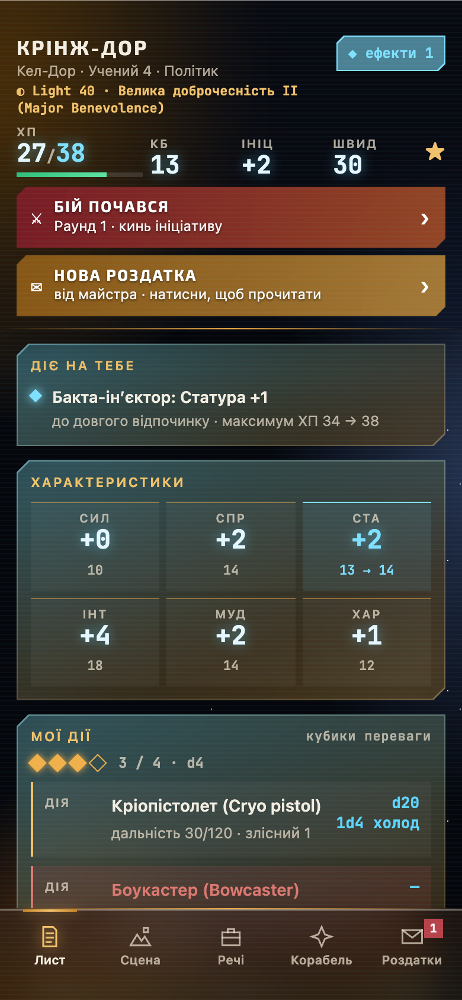
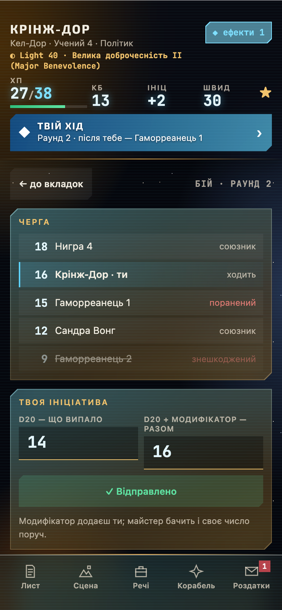
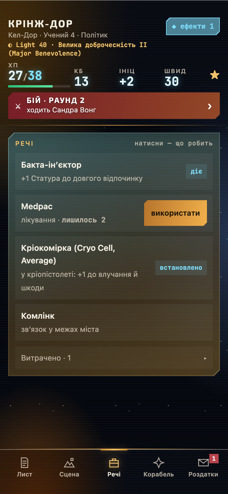
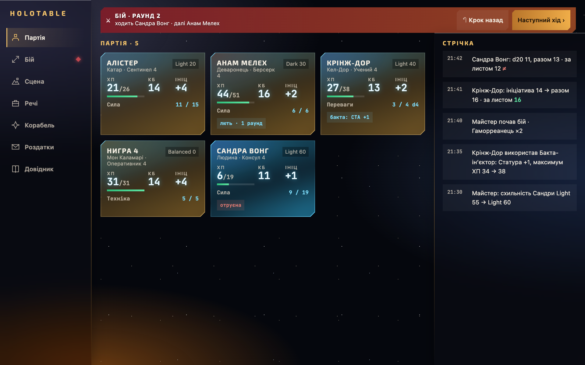
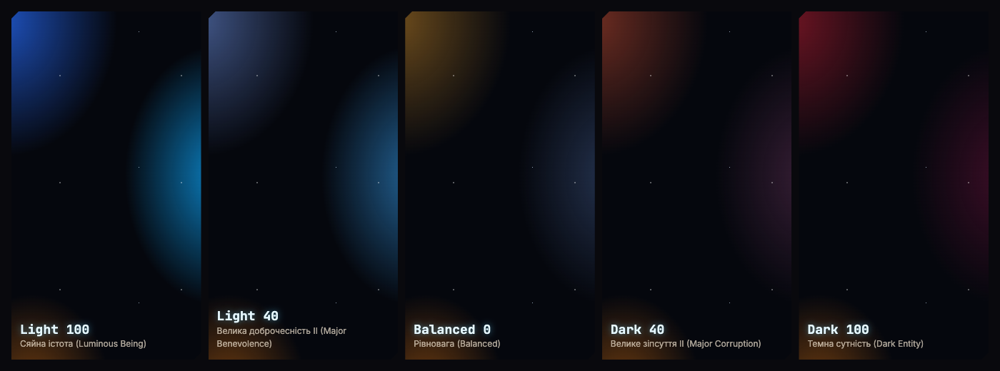

# Дизайн інтерфейсу Holotable

> **Статус:** канон з 28.11.2026. **Стиль — розділ 0, «Бронзова голограма».** Спирається на нього кожна фіча, що змінює вигляд
> екранів: F-114 (дизайн-система), далі F-101, F-102, F-103, F-105, F-109, F-110, F-111
> і F-112. Джерела з датами й висновками — `docs/дизайн/ДЖЕРЕЛА.md`. Чернетка, з якої
> взято частину — `docs/дизайн/sw5e-session-design-uk.md` (що з неї чинне, сказано в
> розділі 13).

Писалось після першого проходу MVP (28.11.2026). Тоді інтерфейс отримав **4 з 10**:
екран майстра не на всю ширину ноутбука, на телефоні не видно ХП і КБ, підказки
вилазять за екран, а вкладок немає зовсім. Нотатки проходу — `docs/ФІЧІ.md`, розділ
«MVP · знахідки першого проходу».

---

## 0. Обраний стиль: «Бронзова голограма»

**Затверджено власником 28.11.2026** після трьох раундів (розділ 14). **Будь-який новий
екран Holotable виглядає так.** Живий еталон з анімаціями — `docs/дизайн/еталон.html`
(відкривається будь-яким браузером); знімки нижче зроблено з нього.

| Телефон: вкладка «Лист» | Телефон: екран бою | Телефон: вкладка «Речі» |
| --- | --- | --- |
|  |  |  |





### Стиль одним абзацом

Темний космос із **туманністю й зорями**. Над ним — **рідке скло скрізь**: статус-смуга,
панелі, плитки, панель вкладок. Скло темне й достатньо щільне, щоб текст читався. Усі
форми — **прямі або зі зрізаними кутами** (верхній лівий і нижній правий), **заокруглень
немає ніде**. Рамки панелей — **градієнт із блакитного в бронзу й золото**. Підписи
панелей — **золоті, великими літерами з розрядкою**. Числа — **моноширинні, світло-блакитні,
з легким світінням**. Ефект, що діє на мене, — **ціан**. Тривога й недоступне —
**приглушений червоний**, ніколи не яскравий. Термінові смуги (бій, роздатка, твій хід) —
**градієнтні плашки згори**: бій — бордовий у мідний, роздатка — бронза в золото, «твій
хід» — синій. **Колір туманності — схильність персонажа** за правилом Force Alignment: синя
для Light, бронзова для Balanced, глибока червона для Dark (F-115). Рух — **дуже повільний**:
туманність дрейфує, зорі мерехтять, по склу раз на пів хвилини проходить відблиск.

### Остаточні токени

Це значення для `apps/web/src/style.css` (F-114). Вони замінюють чернетку розділу 3.

```css
:root {
  --bg: #05070D;                          /* космос під туманністю */
  --text: #F4EEE2;                        /* теплий білий */
  --muted: rgb(236 224 205 / .72);
  --gold: #F2C26A;                        /* підписи панелей, активна вкладка, натхнення */
  --bronze: #9A5A1A;
  --amber: #F2B04A;                       /* кубики переваги, основна кнопка */
  --data: #5FD4FF;                        /* кубики й дані в діях */
  --effect: #7FE0FF;                      /* те, що змінив ефект (F-103) */
  --alert: #E07A72;                       /* недоступне, ворог, тривога — приглушено */
  --ok: #5FE3A1;                          /* смуга ХП, «відправлено» */
  --num: #E6F8FF;                         /* великі числа */
  --num-glow: 0 0 10px rgb(95 212 255 / .5);

  --panel-tint: rgb(14 14 18 / .5);       /* скло панелі: не прозоріше за .5 */
  --bar-tint: rgb(14 14 18 / .45);        /* скло статус-смуги й вкладок */
  --glass-hi: rgb(255 255 255 / .4);      /* світлий край зверху */
  --edge-grad: linear-gradient(160deg, rgb(127 224 255 / .85), rgb(242 194 106 / .35) 50%, rgb(242 194 106 / .8));
  --line-grad: linear-gradient(90deg, transparent, #F2B04A, transparent);

  --strip-combat: linear-gradient(100deg, rgb(130 28 40 / .9), rgb(180 84 40 / .8));
  --strip-mail:   linear-gradient(100deg, rgb(150 96 22 / .88), rgb(222 160 66 / .72));
  --strip-turn:   linear-gradient(100deg, rgb(18 80 140 / .9), rgb(95 212 255 / .62));

  --cut: 10px;                            /* зріз панелі */
  --cut-s: 8px;                           /* зріз смуги, кнопки */

  --f-head: "Exo 2", system-ui, sans-serif;            /* імʼя, заголовки, смуги */
  --f-num:  "JetBrains Mono", ui-monospace, monospace; /* числа, ярлики даних */
  --f-body: system-ui, -apple-system, "Segoe UI", Roboto, sans-serif;
}
```

Плиток і рядків усередині панелей стосуються ще чотири: `--tile: rgb(255 255 255 / .045)`,
`--tile-line` (золота лінія зверху плитки), `--tile-fx` (ціанове тло плитки зі зміною),
`--tile-bad` (бордове тло недоступного). Усе це є в еталоні.

### Тло: туманність схильності

Три шари поверх `--bg`: велика пляма зліва вгорі (`--neb1`), пляма справа посередині
(`--neb2`), мідна жарина внизу ліворуч (`#6E3C10`); над ними два шари зір. `--neb1` і
`--neb2` змішуються між трьома парами кольорів за Alignment Score:

| Схильність | `--neb1` | `--neb2` |
| --- | --- | --- |
| Light 100 | `#1d4fb8` | `#0b7fc0` |
| Balanced 0 | `#6a4a1c` | `#24324e` |
| Dark 100 | `#6a1422` | `#3c0d26` |

Частка дальнього кольору — `√(|бали| / 100)`. Тоді перші яруси вже помітно тонують
небо, а 100 — повний колір. Змішування — `color-mix(in oklab, …)`. Майстер без
схильності — Balanced; на його карточках персонажів туманність кожного проступає
плямою в лівому верхньому куті.

### Анімації: повільні, не втомлюють очей

| Що | Як | Цикл |
| --- | --- | --- |
| Туманність дрейфує | зсув до 2 %, масштаб 1,04 → 1,09, туди й назад | 90 с |
| Зорі мерехтять | лише другий шар, прозорість 0,45 → 0,95 | 14 с |
| Відблиск по склу | світла смуга проходить статус-смугою, решту часу стоїть | 22 с |
| Рамки переливаються | градієнт рамки панелі повільно зсувається | 30 с |
| Числа дихають | світіння чисел 0,32 → 0,62 | 10 с |
| Термінові смуги дихають | яскравість 1 → 1,14, доки не відкрили | 5 с |
| Рядки розгортки | ледь помітні, повзуть донизу | 40 с |

Нічого не блимає частіше, ніж раз на 5 секунд. Анімуються лише `transform`, `opacity`,
`filter` і положення фону, а не розміри. Під `prefers-reduced-motion: reduce` і
перемикачем «Анімації» в застосунку все стоїть. Лишаються колір і число.

### Як будувати новий екран у цьому стилі (для сесій АІ)

1. **Відкрий еталон** `docs/дизайн/еталон.html` і знайди найближчий екран. Компоненти
   звідти (`.pn`, `.ug`, `.st`, `.a`, `.w`, `.q`, `.it`, `.field`, `.btn`, `.tabs`)
   переносяться в застосунок як є.
2. **Кожен блок даних — панель `.pn`**: скляна, зріз `--cut`, рамка `--edge-grad`,
   заголовок золотими великими літерами.
3. **Жодного `border-radius`.** Кути — лише `clip-path` зі зрізом. Виняток — нуль.
4. **Кольори — лише токени.** Нового кольору немає, доки його не дописано сюди.
5. **Числа** — `--f-num`, `--num`, `tabular-nums`, світіння `--num-glow`. **Слова** —
   системним шрифтом.
6. **Червоний — лише `--alert` і приглушені градієнти.** Яскравого червоного немає.
7. **Термінове — згори**, смугою `.ug` (розділ 6), а не спливним вікном.
8. **Текст на склі** — тон панелі не прозоріший за `.5`; перевір контраст над найсвітлішою
   ділянкою туманності.
9. **Рух** — лише з таблиці вище; новий рух дописується туди з циклом не коротшим за 5 с.
10. **Зроби знімок** нового екрана так само, як ці: `еталон.html?shot=<назва>` у
    безголовому Chrome, 390 × 844 при масштабі 2 для телефона. Поклади його в
    `docs/дизайн/знімки/`.

---

## 1. Напрям: імперський термінал під склом

Два шари, які не змішуються.

**Структура — гострі кути.** Усе, що тримає дані, — панелі, картки, кнопки, рядки
черги — має форму бортового терміналу: зрізані кути, тонкі світні лінії, дрібні
підписи великими літерами з розрядкою, моноширинні числа. Орієнтири — ігри й серіали
жанру: Star Wars: The Old Republic, Knights of the Old Republic, Andor, Empire at War,
Battlefront. Беремо з них **мову форм**, а не речі:
- **з Andor** — «клінічний» імперський інтерфейс: здебільшого чорне й біле, червоний
  лише для тривоги, мінімум прикрас, «майже тільки дані»;
- **зі SWTOR** — свідома легкість: ніяких складних обрисів і перевантажених рамок,
  тексту стільки, скільки треба для дії;
- **з Battlefront і Star Wars: Hunters** — кутасті контейнери, нахил уперед, зрізані
  кути, сегментовані рамки;
- **з KOTOR** — антиприклад: його інтерфейс критики називали захаращеним. Цього
  уникаємо.

**Поверх структури — рідке скло (Liquid Glass з iOS 26).** Склом стає лише те, що
**плаває над вмістом**: нижня панель вкладок, верхня статус-смуга, висувні аркуші,
сповіщення. Під склом ніколи не лежить текст, який людина читає як абзац. Так робить і
сама Apple: скло — для елементів керування, а не для вмісту.

**Чого не робимо ніколи:** логотипів, кадрів, шрифтів і графіки з ігор та фільмів,
імен персонажів франшизи в інтерфейсі, ауребешу як значущого тексту. Форми — свої,
натхнення — жанрове. SW5e — фанатський проєкт, і Holotable лишається нейтральним
застосунком для столу.

---

## 2. Принципи

1. **Спершу стіл, потім атмосфера.** Число ХП читається з відстані витягнутої руки
   швидше, ніж помічаєш світіння. Якщо ефект заважає прочитати — ефект іде.
2. **Один великий палець.** Часті дії — в нижній половині екрана; ціль натиску не
   менша за 44×44 px (Apple HIG; 48 dp у Material; мінімум WCAG 2.2 — 24 px).
3. **Застосунок не рахує за гравця** (ADR 0007). Він каже, який кубик, а людина кидає,
   додає своє й вписує суму. Тому в нас **немає** кнопки кидка й лотка кубиків, які
   пропонувала чернетка.
4. **Нічого не пливе й не вилазить за екран.** Довгий термін, двомовна назва
   «Витонченість (Finesse)», помилка під полем — усе переноситься в межах екрана.
   Правила — розділ 7.
5. **Передбачуваність понад ефектність.** Елементи керування не стрибають, не
   зникають і не міняють місця. Рух — лише щоб щось повідомити.
6. **Темна тема за замовчуванням.** Грають увечері, за приглушеного світла.
7. **Без інтернету, без нових пакетів.** Шрифти й значки лежать у репозиторії
   файлами (ADR 0004; політика безпеки сторінки й так пускає лише `'self'`).

---

## 3. Токени

> **Замінено розділом 0** (28.11.2026): остаточні токени — там. Нижче — перша чернетка,
> лишена для історії вибору.

Усі кольори, відступи й зрізи живуть змінними CSS у `apps/web/src/style.css` (F-114).
Сирих кольорів у компонентах немає.

```css
:root {
  /* Поверхні: космос, картка, піднята картка */
  --bg:        #07090F;
  --surface-1: #0E1320;
  --surface-2: #161D2E;
  --edge:      #24304A;   /* тонка рамка панелі */
  --edge-lit:  #3A4C70;   /* рамка активного, наведеного */
  --text:      #E6ECF5;
  --text-muted:#8C9AB3;

  /* Акценти: кольори клинків */
  --accent-blue:   #4FB4FF;  /* основний, фокус, посилання */
  --accent-green:  #4BE38A;  /* лікування, успіх */
  --accent-red:    #FF4D5E;  /* шкода, тривога, темний бік */
  --accent-purple: #B07CFF;  /* Сила (force points) */
  --accent-amber:  #FFB547;  /* техніка (tech points), попередження */

  /* Значення */
  --hp: var(--accent-green);  --hp-low: var(--accent-amber);  --hp-critical: var(--accent-red);
  --force: var(--accent-purple);  --tech: var(--accent-amber);
  --side-light: var(--accent-blue);  --side-dark: var(--accent-red);  --side-universal: #9FB0C8;
  --effect: var(--accent-blue);   /* число, яке змінив ефект (F-103) */

  /* Скло: темний тон щільний, бо під ним бувають числа */
  --glass-tint:      rgb(14 19 32 / 0.72);
  --glass-highlight: rgb(255 255 255 / 0.14);
  --glass-shadow:    0 8px 24px rgb(0 0 0 / 0.45);

  /* Зрізані кути */
  --cut-sm: 6px;  --cut-md: 10px;  --cut-lg: 14px;

  /* Відступи: крок 4 px */
  --space-1: 4px; --space-2: 8px; --space-3: 12px; --space-4: 16px; --space-6: 24px; --space-8: 32px;

  /* Світіння — лише для активного й тривоги */
  --glow-sm: 0 0 6px  color-mix(in srgb, currentColor 60%, transparent);
  --glow-md: 0 0 14px color-mix(in srgb, currentColor 45%, transparent);
}
```

**Контраст.** Кожна пара тексту й тла — не нижче WCAG AA: 4,5:1 для тексту, 3:1 для
великих чисел і меж елементів. Для скла міряємо **в найгіршому місці**, тобто над
найсвітлішим вмістом під ним, а не в середньому. Колір ніколи не несе зміст сам: у ХП є
число, у боку Сили — слово, у недоступної зброї — пояснення, а не лише червоне.

---

## 4. Форма: зрізані кути

**Основний спосіб — `clip-path: polygon(...)`.** Він працює всюди, зокрема в Safari на
iPhone. Новіший `corner-shape: bevel` простіший, але станом на 2026 рік є лише в
Chromium, а в Safari на iOS його немає. Тому він тільки поліпшення всередині
`@supports (corner-shape: bevel)`, а без нього форма мусить бути та сама.

**Зрізаємо один-два кути, не чотири:** верхній лівий і нижній правий. Так виглядає
жанр, а не шестикутник. Розмір зрізу пропорційний елементу: кнопка — `--cut-sm`,
картка — `--cut-md`, аркуш — `--cut-lg`.

**Рамка.** `clip-path` зрізає й рамку, тому вона малюється двома шарами: зовнішній шар
кольору `--edge` з тією самою формою, а над ним внутрішній шар кольору поверхні, втягнутий
на 1 px.

```css
.panel {
  --cut: var(--cut-md);
  --shape: polygon(var(--cut) 0, 100% 0, 100% calc(100% - var(--cut)),
                   calc(100% - var(--cut)) 100%, 0 100%, 0 var(--cut));
  position: relative;
  isolation: isolate;
  padding: var(--space-4);
}
.panel::before, .panel::after { content: ""; position: absolute; z-index: -1; clip-path: var(--shape); }
.panel::before { inset: 0;   background: var(--edge); }        /* рамка */
.panel::after  { inset: 1px; background: var(--surface-1); }   /* поверхня */
```

**Фокус.** Рамку фокусу `clip-path` теж обрізає, і стандартний `:focus-visible` її не
повторює. Тому фокус малюємо всередині: на фокусі колір рамки міняється на
`--accent-blue` і додається `--glow-sm`. Без видимого фокусу керувати з клавіатури
неможливо, а майстер працює на ноутбуці.

---

## 5. Скло: де, як і коли ні

**Де:** з 28.11.2026 (рішення власника, розділ 0) — **скрізь**: панель вкладок,
статус-смуга, висувні аркуші, сповіщення **і панелі вмісту**. Ціна цього — дві умови:
тон панелі під текстом не прозоріший за `.5` (`--panel-tint`), і перемикач «Без скла»
обовʼязковий. Плитки й рядки всередині панелі — не скло, а напівпрозора заливка
`--tile`: розмиття двічі одне над одним не кладемо.

**Скільки:** `backdrop-filter` прораховується окремо для кожного елемента, а на
прокрутці довгого списку зі склом слабкий телефон гальмує. Тому скло — на панелях, а
не на кожному рядку; розмиття панелі — 16 px, смуг — 20 px. Як воно поводиться на
телефонах столу, перевіряє F-114.

```css
.glass {
  background: var(--glass-tint);
  /* Значення прямо, без змінних: за одним із джерел, Safari не підставляє змінні
     всередині -webkit-backdrop-filter. Перевірити на iPhone в F-114. */
  -webkit-backdrop-filter: blur(20px) saturate(160%);
  backdrop-filter: blur(20px) saturate(160%);
  box-shadow: var(--glass-shadow), inset 0 1px 0 var(--glass-highlight);
}
/* Старий браузер — щільна поверхня, а не прозорість без розмиття */
@supports not ((backdrop-filter: blur(1px)) or (-webkit-backdrop-filter: blur(1px))) {
  .glass { background: var(--surface-2); }
}
/* Людина просила більше контрасту чи менше прозорості — скла немає */
@media (prefers-contrast: more), (prefers-reduced-transparency: reduce) {
  .glass { background: var(--surface-2); -webkit-backdrop-filter: none; backdrop-filter: none; }
}
:root[data-glass="off"] .glass { background: var(--surface-2); -webkit-backdrop-filter: none; backdrop-filter: none; }
```

**Перемикач «Без скла» — у самому застосунку.** Safari не підтримує
`prefers-reduced-transparency`, тож системне «Зменшити прозорість» на iPhone до
сторінки не доходить. Вибір зберігається в браузері людини (`localStorage`); він для
зручності, не для стану гри.

**Справжнього заломлення, як в iOS, на вебі немає:** вбудовані фільтри не зсувають
пікселі, а SVG-фільтри в `backdrop-filter` браузери підтримують по-різному. Беремо
розмиття, тон і світлий край зверху — цього досить, щоб скло читалось як скло.

**Відома критика й наші відповіді.** Nielsen Norman Group (жовтень 2025) пише, що в
iOS 26 прозоре стає «невидимим», текст на тексті — нечитабельним, а елементи керування
затуляють вміст і рухаються без потреби. Тому в нас:
- щільний тон 0,72 там, де під склом бувають числа;
- скло лише на краях екрана й ніколи на вмісті;
- жодних елементів, що ховаються чи складаються самі на прокрутці;
- рух лише як сигнал (розділ 10).

---

## 6. Навігація й вкладки

### Телефон (360–430 px)

```
┌───────────────────────────────────┐
│ КРІНЖ-ДОР · Учений 4      ◆ефекти 1│  статус-смуга (скло, завжди видно)
│ ХП 27/34   КБ 13   ІН +2   ШВ 30 ★│
├───────────────────────────────────┤
│ ⚔ БІЙ ПОЧАВСЯ · кинь ініціативу  › │  термінова смуга: зʼявляється згори
│ ✉ НОВА РОЗДАТКА від майстра       › │  і стоїть, доки не відкрив
├───────────────────────────────────┤
│   вміст вкладки (прокрутка)       │
│   панелі зі зрізаними кутами      │
├───────────────────────────────────┤
│ Лист  Сцена  Речі  Корабель Роздатки│  панель вкладок (скло)
└───────────────────────────────────┘
```

**Бій і роздатки — термінові повідомлення згори** (рішення власника 28.11.2026). Вони
виїжджають під статус-смугою, і гравець помічає їх, на якій би вкладці не був:
- **Бій.** Майстер почав бій — згори виїжджає «⚔ БІЙ ПОЧАВСЯ · кинь ініціативу» і
  пульсує. Поки бій триває, смуга лишається компактною: «БІЙ · раунд 2 · ходить
  Сандра». Коли настає мій хід, вона знову засвічується: «ТВІЙ ХІД». Натиск відкриває
  **екран бою** поверх вкладок: ініціатива, мої дії, черга. «← до вкладок» повертає
  назад, а смуга бою лишається. Скінчився бій — смуга від'їжджає.
- **Роздатка.** Нова роздатка — «✉ НОВА РОЗДАТКА від майстра» згори, пульсує, доки її
  не відкрили. Натиск відкриває саму роздатку. Усі отримані лежать у вкладці
  «Роздатки»; ту, яку майстер відкликав, звідти прибрано.
- Дві смуги одночасно — одна під одною, бій вище. Більше двох не буває.
- Це **не** спливне вікно поверх вмісту: смуга займає своє місце в потоці й зсуває
  вміст униз, нічого не затуляючи. Так вона не стає «плаваючим склом над текстом», за яке
  критикують iOS 26.

**П'ять вкладок унизу, завжди на своїх місцях:** **Лист · Сцена · Речі · Корабель ·
Роздатки.** П'ять — межа і в Apple, і в Material. Підписи до восьми літер вміщаються в
360 px поруч зі значком.

- **Лист:** характеристики, сейви, навички, риси, сили й техніка з вартістю, мої дії
  (поза боєм — щоб подивитись, що вмію).
- **Сцена:** НПС, яких показав майстер, погода, скільки людей за столом (лише число;
  список «За столом» на телефоні не потрібний).
- **Речі:** інвентар, «використати», лічильник «лишилось N», витрачене згорнуто.
- **Корабель:** стан корабля, моя станція, що я можу зараз.
- **Роздатки:** усе, що роздав майстер, нове — зверху.

**Статус-смуга** тримає те, що в чернетці звалось «2 секунди»: ХП (поточні / максимум,
тимчасові окремо), КБ, ініціатива, швидкість, натхнення, а також значок **◆ Ефекти**:
скільки ефектів зараз діє на мене, натиск — аркуш зі списком («Бойовий стимулятор: Сила
+1 · до твого наступного ходу»). Саме це закриває нотатку «бонуса не видно» (F-103).
Числа моноширинні, з `tabular-nums`, щоб не стрибали при зміні.

**Вибір вигляду.** Вісім варіантів оформлення одного й того самого екрана —
`docs/дизайн/варіанти.html` (відкривається будь-яким браузером, без інтернету). Який
обрано, записується сюди.

### Ноутбук майстра (від 1024 px)

Ті самі назви вкладок і ті самі компоненти — «екран майстра підпорядковується тим самим
правилам» (нотатка столу). Відрізняються лише ширина й керування.

```
┌──────┬───────────────────────────────────────┬──────────────┐
│Партія│                                       │  Стрічка      │
│Бій • │   основна область на всю ширину       │  (або картка  │
│Сцена │   (без max-width посередині)          │   вибраного)  │
│Речі  │                                       │              │
│Корабл│                                       │              │
│Роздат│                                       │              │
│Довідн│                                       │              │
└──────┴───────────────────────────────────────┴──────────────┘
```

- Ліва колонка — вертикальні вкладки: **Партія · Бій · Сцена · Речі · Корабель ·
  Роздатки · Довідник.** «Партія» в майстра — це «Лист» гравця, тільки на всіх пʼятьох.
  У майстра «Бій» — вкладка, бо бій веде він; смуга «БІЙ · раунд N» згори в нього теж є.
- Права колонка — стрічка змін; коли щось вибрано (ворог, персонаж), там його картка.
- **Ширина — весь екран.** Нинішній `max-width: 44rem` на `main` прибирається для
  майстра; для довгих абзаців (довідник) обмежується лише ширина рядка тексту
  (`max-inline-size: 70ch`), а не всього екрана.
- Від 768 до 1023 px права колонка ховається в аркуш; до 767 px екран майстра
  розкладається як телефонний.

---

## 7. Тексти не пливуть і не вилазять: правила верстки

Це головне, що зламалось на телефоні. Кожне правило — перевірка в F-111.

1. **Кожен елемент флекса й сітки має `min-width: 0`.** Без цього флекс-елемент не
   стискається вужче за найдовше слово й виштовхує сусідів за екран. Для колонок —
   `min-height: 0`. Сітки — `minmax(0, 1fr)`, а не `1fr`.
2. **Імена, терміни й назви — `overflow-wrap: anywhere`.** На відміну від `break-word`,
   воно зменшує мінімальну ширину флекс-елемента, тому довге слово ламається, а не
   розпирає рядок.
3. **Числа не обрізаються ніколи.** Обрізати трьома крапками можна лише другорядний
   текст, і тоді повний текст відкривається натиском.
4. **Підписи можуть займати два рядки.** Дизайн розрахований на найдовший рядок —
   двомовний термін «Витонченість (Finesse)» удвічі довший за англійський.
5. **Жодних фіксованих ширин у пікселях для тексту.** Ширини — у `%`, `ch`, `fr` або
   `clamp()`.
6. **Висота екрана — `100dvh`, не `100vh`.** На телефоні `100vh` — це висота з
   прихованою панеллю браузера, тому низ сторінки обрізається. Нинішній
   `min-height: 100vh` на `main` — саме ця помилка.
7. **Безпечні зони:** панель вкладок і статус-смуга мають `padding` на
   `env(safe-area-inset-bottom)` і `env(safe-area-inset-top)`. `viewport-fit=cover`
   у `index.html` уже стоїть.
8. **Поля введення — шрифт не менший за 16 px.** Інакше Safari на iPhone збільшує
   сторінку, щойно торкнешся поля. Масштаб пальцями не забороняємо (`maximum-scale`
   ламає доступність).
9. **Підказки й помилки — у потоці або в аркуші, не «плаваючи».** Помилка поля —
   рядком під полем, на всю ширину. Підказка «звідки число» на телефоні — висувний
   аркуш знизу на всю ширину. На ноутбуці — спливне вікно з
   `max-inline-size: min(22rem, calc(100vw - 2rem))`, яке відкривається натиском, а не
   браузерним `title` з затримкою (F-110). Нативні засоби — `popover` і `<dialog>`,
   без бібліотек.
10. **Перевірка шириною:** 360, 375, 390, 393, 412 і 430 px, а також збільшення тексту
    до 200 %. Сітка `ТЕСТ-4-ЕКРАНИ` дає вузькі панелі, і вона вже є першою перевіркою.

---

## 8. Типографіка

| Роль | Шрифт | Розмір: телефон / ноутбук |
| --- | --- | --- |
| Текст | системний: SF Pro на iPhone, Roboto на Android, Segoe UI на Windows | 16 / 15 px |
| Заголовки й підписи-мітки | **Exo 2** (OFL, є кирилиця), файлом у репозиторії | 20 / 24 px; мітки 12–13 px, великими, розрядка `.08em` |
| Числа (ХП, КБ, кидки) | **JetBrains Mono** (OFL, є кирилиця), файлом, `tabular-nums` | 28–40 px у статус-смузі |

- **Системний шрифт для тексту.** Він найкраще звучить кирилицею, нічого не важить і
  виглядає рідним поруч зі склом iOS.
- **Шрифти — файлами `woff2` у `apps/web/public/fonts/`** разом із текстом ліцензії
  OFL. Не з Google Fonts: інтернету за столом немає, а сторінка пускає лише свої файли.
  Не npm-пакетом: це новий пакет (ADR 0004 і правило 10 `CLAUDE.md`). Беремо
  підмножину: латиниця + кирилиця.
- `font-display: swap`: поки шрифт вантажиться, текст уже видно системним.
- **Orbitron не беремо** — у нього немає кирилиці. **Ауребеш** — лише як орнамент, якщо
  взагалі; значущого тексту ним не пишемо.

---

## 9. Компоненти

Кожен компонент живе один раз і використовується і в гравця, і в майстра.

| Компонент | Стани | Де і для чого |
| --- | --- | --- |
| `StatusStrip` | звичайний / мій хід / без свідомості | верх телефона: ХП, КБ, ІН, ШВ, ★, ✉, ◆ (F-101) |
| `TabBar` | вкладка: звичайна / активна / з новим | низ телефона, ліва колонка ноутбука (F-101, F-102) |
| `UrgentStrip` | бій почався / бій триває / твій хід / нова роздатка | термінова смуга згори; зсуває вміст, не затуляє (розділ 6) |
| `Panel` | звичайна / активна / тривога | будь-який блок даних; зрізані кути (розділ 4) |
| `StatTile` | число / число зі зміною від ефекту | КБ, ініціатива, швидкість; змінене — `--effect` і «звідки» (F-103) |
| `HpBar` | норма / ≤50 % / ≤25 % / 0 — без свідомості | смуга й число; на нулі — лише рятівні (F-095) |
| `PoolPips` | Сила / техніка / суперіориті; точки до 12, далі число | витрата натиском |
| `ActionGroup` | Дія / Бонусна дія / Реакція / Інше | хід гравця: зброя, сили, маневри (F-107) |
| `ActionCard` | доступна / недоступна (червона, з поясненням) | зброя чи сила; вартість і DC |
| `EffectChip` | діє / злітає на цьому ході / знятий | рядок ефекту: що, на скільки, до коли (F-103) |
| `RollInput` | d20 / d20 + модифікатор / лише кубик | підписи полів і «Відправити» (F-108) |
| `InitiativeRow` | ходить / союзник / ворог / знешкоджений | черга; у майстра «змінити» й «прибрати» (F-096, F-099, F-100) |
| `Sheet` | аркуш знизу (телефон) / вікно (ноутбук) | «звідки число», ефекти, роздатки; на `<dialog>` |
| `Explain` | закрито / відкрито | натиск на число — одразу пояснення (F-110) |
| `Toast` | інфо / успіх / з «Скасувати» | не перекриває панель вкладок |
| `Badge` | число / пульс | ◆ Ефекти, вкладка «Роздатки» |

**Вітрина.** F-114 додає сторінку `/?as=styleguide` — усі компоненти в усіх станах на
одному екрані. Нею власник приймає вигляд, а наступна сесія бачить, що вже є.

---

## 10. Рух

> **Замінено розділом 0, «Анімації»** (28.11.2026): усі цикли повільні, від 5 до 90 секунд,
> і перелік — там. Нижче — лише правила, що лишились чинними.

- **Рух лише як сигнал або як повільне тло.** Жодних «живих» кнопок, що ворушаться самі
  (критика NN/g).
- Термінова смуга виїжджає згори за 200 мс; вкладки й аркуші — зсув і прозорість за
  150–200 мс.
- `prefers-reduced-motion: reduce` і перемикач «Анімації»: дрейф, мерехтіння й дихання
  вимкнені, лишаються статичні колір і число.
- Вібрація телефона — не обіцяємо: на iPhone сторінка її не має.

---

## 11. Доступність

- Контраст WCAG AA, і для скла — у найгіршому місці (розділ 3).
- Перемикач «Без скла» в застосунку (розділ 5), бо системний на iPhone до сторінки не
  доходить.
- Видимий фокус, не обрізаний формою (розділ 4).
- Цілі натиску — не менші за 44×44 px.
- Масштаб тексту до 200 % без поломки й без горизонтальної прокрутки.
- Усі кнопки — справжні `button`, поля — `input`; ARIA лише там, де без неї не можна.
- Зміни, які приходять самі (почався бій, мій хід, роздатка), оголошуються через
  `aria-live="polite"`.

---

## 12. Як перевіряти

**Власник:** відкриває вітрину `/?as=styleguide` і сітку `ТЕСТ-4-ЕКРАНИ`; на телефоні
проходить вкладки. Вердикт «зручно на N з 10» записується в журнал перевірок
`docs/ПРОГРЕС.md`.

**АІ, автоматично (F-114 і далі):**
- тест-сторож CSS: немає `100vh`; немає `url(http…)` і зовнішніх шрифтів; поля
  введення не дрібніші за 16 px; кольори в компонентах — лише змінними;
- рендер компонентів у ролях гравця й майстра, як уже роблять тести F-031, F-072;
- скриншоти в браузері на ширинах розділу 7, коли браузер у середовищі є (правило 8
  `CLAUDE.md`).

---

## 13. Що взято з чернетки, а що ні

Чернетку `docs/дизайн/sw5e-session-design-uk.md` писала окрема сесія, яка не бачила цього
застосунку. З неї чинне лише те, що перенесено сюди.

| Взято | Відкинуто — і чому |
| --- | --- |
| Темна тема, кольорові токени (розділ 8.2 чернетки) | Кнопки кидків, лоток кубиків, «застосунок рахує сам» — ADR 0007 |
| Ціль натиску, нижня панель вкладок, safe-area, `@container` | Шрифти з Google Fonts — без інтернету й поза політикою безпеки; беремо файлами |
| Exo 2 і JetBrains Mono (є кирилиця), без Orbitron | Lucide чи Tabler як пакет — новий пакет; значки малюємо самі SVG |
| Компоненти `HpBar`, `PointPool`, `ConditionChip`, `InitiativeRow`, `BottomSheet`, `Toast` | Laravel, Vue, Reverb, PWA з IndexedDB, код кімнати — у нас Node, React і журнал подій (ADR 0002, 0005) |
| `prefers-reduced-motion`, контраст AA, видимий фокус | Зоряне тло й паралакс, ефект гіперстрибка на натуральній 20 — кидки не в застосунку |
| Hover лише під `@media (hover: hover)` | Перетягування черги, свайпи — майстрові потрібні явні кнопки (F-099, F-100) |
| | Модель даних чернетки — у нас формат sw5e.com (ADR 0001) і нічого обчислюваного на диску (ADR 0003) |

---

## 14. Хід вибору вигляду

**Раунд 1 (28.11.2026)** — `docs/дизайн/варіанти.html`, вісім стилів. Сподобались **7 «Рідке
скло»**, **6 «Повстанська майстерня»** і **1 «Голостіл»**. Рішення власника:
- **основа — весь стиль варіанта 7**: скло не лише на краях, а й на панелях, над
  кольоровим тлом-туманністю. Це змінює розділ 5: склом можуть бути й панелі вмісту.
  Щоб текст на такому склі лишався читабельним, тон панелі під текстом — не прозоріший
  за 0,5 темного, і контраст міряється в найгіршому місці (розділ 3); перемикач «Без
  скла» обовʼязковий;
- **поверх — прийоми з 6 і 1**: смугасті термінові смуги й трафаретні підписи (6), тонкі
  світні лінії й зоряне тло (1);
- **палітра — як у SWTOR**: помаранчевий, червоний і синій, **градієнтами**;
- **жодних заокруглених кутів** — лише прямі й зрізані.

**Раунд 2** — `docs/дизайн/варіанти-2.html`, вісім варіантів на цій основі. Рішення власника:
- **тло — з варіанта 1 «Республіканське скло»**: туманність і зорі;
- **кольори — з варіанта 7 «Бронзове скло»**: золото-помаранчеві рамки й підписи, сині
  дані, **але без яскравого червоного** — червоний лише приглушений, глибокий;
- **колір тла — це схильність персонажа** до світлої чи темної сторони: синій — світло,
  червоний — темрява (у тих, хто володіє Силою, — джедаї й сітхи). Схильність виставляє
  майстер кожному гравцеві. Шкала — з книги, варіантне правило **Force Alignment**:
  Alignment Score від Light 100 через 0 (Balanced) до Dark 100. Фіча — **F-115**.

**Раунд 3** — `docs/дизайн/варіанти-3.html`: вісім мішанок стилів раунду 1 на цій основі,
з перемикачем схильності. **Обрано 7 «Бронзова голограма»** (28.11.2026) — з повільними
анімаціями. Опис, токени, знімки й правила — розділ 0, живий еталон — `docs/дизайн/еталон.html`.

Закрито 28.11.2026: бій і роздатки — термінові смуги згори (розділ 6), тож шоста кнопка
внизу не потрібна, а вкладці «Бій» не треба ні зникати, ні приглушуватись.
